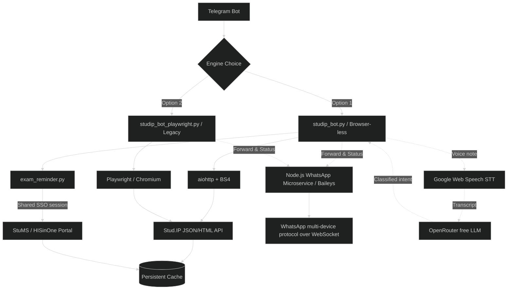

# 🎓 Uni Oldenburg Study Assistant Bot

<div align="center">


</div>

The ultimate Telegram companion for students at the **University of Oldenburg**. This bot seamlessly bridges the gap between the **Stud.IP** portal and your daily messaging app, providing real-time intelligence on your academic life.

---

## 🌗 Choose Your Engine

This project offers two distinct ways to interact with Stud.IP. You can select your preferred engine during the initial setup via `setup.sh`.

| Feature | 🚀 Browser-less (Standard) | 🌐 Playwright (Legacy) |
| :--- | :--- | :--- |
| **Logic** | Direct JSON/HTML requests | Simulated Browser (Chromium) |
| **Speed** | ⚡ Instant Sync | 🐢 Slower (Browser overhead) |
| **RAM Usage** | ~50MB - 100MB | ~500MB - 1GB+ |
| **Stability** | High (No browser crashes) | Medium (Requires display/driver) |
| **Best For** | Production/Cloud Servers | Local Desktop / Debugging |
| **File** | `studip_bot.py` | `studip_bot_playwright.py` |

---

## ✨ Power Features

### 📅 Smart Scheduling & Reminders
*   **Morning Summary (07:00 AM)**: Get a daily briefing delivered to your chat, automatically **pinned** so it's always one tap away at the top of the chat — pinning isn't automatic in Telegram (a pinned message stays pinned forever otherwise), so yesterday's summary is unpinned first each morning before today's is pinned, keeping exactly one summary pinned at a time. Everything AI-generated in it (lunch pick, outfit try-on image, voice narration) is prepared from 06:30, then the whole summary is sent at once at exactly 07:00 instead of trickling in while it's being generated. If the bot starts after 07:00, it prepares and sends right away.
    *   **⏳ Exam countdown**: every registered exam you still have ahead of you gets its own line — name and "in N days" (or "tomorrow"/"today") — right in the same pinned summary, not just the nearest one. Updates automatically every morning along with everything else.
    *   **Today's Schedule**: A clean list of your lectures and locations.
    *   **🌤️ Weather**: Free, keyless [Open-Meteo](https://open-meteo.com) data for **📍** whatever location you've set via `/status → "📍 Set Location"` (just type a city/place name — it's geocoded automatically; defaults to Uni Oldenburg's coordinates if you've never set one), focused on the 8–11 AM leaving-home window specifically (not a whole-day average — a stormy afternoon shouldn't spoil a clear morning read, or hide a wet one). What matters is whether it'll be dry, rainy, sunny etc. and what to bring — not the exact degree count — so it comes with a one-line prep tip (umbrella, warm coat, ...). Skipped quietly if the weather service is unreachable. Also shown on the interactive **📅 Today** view (not just this automatic summary), feeds **💬 Voice Q&A** (below), and adjusts **Lecture Reminders** (below) for a wet first class of the day.
    *   **✅ Today's Tasks**: Any personal task/reminder due today (see ✅ Personal Tasks & Reminders below) is listed right alongside the schedule — only shown when there's actually one due that day.
    *   **🍽️ Lunch pick**: the same AI-judged dish pick as **"What should I eat?"** (see 🍽️ Enhanced Mensa Menu below), folded straight into the summary — no separate ask needed. Comes with the dish name/location in the text, a photo of the dish when one can be matched, and it's woven naturally into the spoken briefing below too.
    *   **Mensa Menu**: The full cafeteria menu with allergens and special labels (e.g., ⭐ Limited).
    *   **🔊 Spoken briefing, automatically**: right after the text summary, a second message arrives as an actual voice note — a warm, upbeat narration of the day (weather, schedule, today's tasks, *and* the lunch pick, all woven in naturally, clothing advice included) that a free OpenRouter LLM writes fresh every morning (not a fixed template — the opening line and phrasing are different every time), turned into speech by the same free TTS pipeline as **🔊 Listen** (see 🎙️ Voice Commands). No tap needed; if generation or conversion fails, it's skipped quietly and the text summary above still went out. If you've set your name via **/status → "👤 Set Your Name"**, the narration greets you by it.
*   **Lecture Reminders**: Automatically receive a notification **30 minutes before** each class starts. No more running late across campus! For the day's **first** class specifically, a wet forecast (see 🌤️ Weather above) widens that to **~45 minutes** and adds a heads-up to grab an umbrella — later classes are just a walk across campus, so only the actual leaving-home commute gets the extra lead time.
*   **📚 Good Times to Study**: The weekly plan (**📆 Week Plan**) flags free windows squeezed *between* two classes on the same day (at least 90 minutes, so there's actually enough time to get something done) as good study time, showing when and what they're sandwiched between. The **🔊 Listen** weekly narration mentions the best one or two naturally too, as a nudge for revision or homework.
*   **⏱️ Workload-Aware Planning**: the weekly study plan schedules by *time*, not "one lecture per slot". Each lecture becomes concrete tasks with an estimate: slides by page count (2 min/page), videos by the weekly README's stated recording time (otherwise from file size, calibrated on weeks where the README states it; ×1.25 for pausing and notes), quizzes (5 min/question), problem sets in `PS/` folders (15 min/question) and empirical projects in `EP/` folders (1 h per instruction page, 2 to 6 h). When a weekly README names the slide decks, only those count (other PDFs are optional readings). For flipped-classroom courses with dated weekly folders, the material of upcoming classes is scheduled *before* the class (top priority from 2 days before), then catch-up, exam prep and previews. Long tasks are split across blocks, short ones share a block. The plan opens with needed vs. free hours per course and flags what doesn't fit or which class can't be fully prepared. Ticking a session credits its minutes to its tasks; a lecture counts as studied once all its tasks are done, and `/progress` shows the hours left per course and lecture.
*   **📄 Exam Dates From Course Files**: once a day the bot scans your tracked courses' files (syllabus/info sheets, READMEs and slides, PDF/PPTX/HTML, including `Syllabus/` folders; past exam papers are skipped) for exam, retake, midterm, presentation and submission dates. Only passages that mention an exam next to a date (or the exam format) go to the free LLM for extraction, and results are cached per file, so unchanged files are never re-processed. Dates are sanity-checked: if a file names a weekday that doesn't match its year (e.g. an info sheet reused from last year saying "Friday, 12 February 2026" in WS 26/27), or gives no year, the year is corrected and flagged. New or changed dates are announced right away. They also show up in **📚 My Exam Dates** (with a **📄 Scan Course Files Now** button), count towards the weekly study plan's exam priority, and get reminders 7/3/1/0 days before (skipped when StuMS already has a registered sitting that day; retakes only once the main exam has passed). Format-only info ("oral exam at the end of the course", "date set in the first session") is listed as *date not announced yet*.
*   **📘 Weekly Content-Aware Study Plan & Progress Tracking**: toggle on in `/status` and every Sunday evening (or any time via **`/studyplan`**), the bot scans your **enrolled** courses' lecture files (PDF/PPTX/HTML slides, top level plus one folder down, so weekly dated folders like `20261013/` are included; books, literature, code and problem-set folders are skipped) and tags each with a short topic label (cached, unchanged files are never re-processed). Lectures are put in **teaching order** (dated folders, or `L3`/`Lecture 04`/`03_` numbering), compared against the lectures **already held** according to your calendar (cancelled ones excluded), and against what you've marked as studied. Next week's free time (mornings, afternoons and gaps between classes, 10:00 to 21:00, weekdays only) is then filled in order: first the lectures you're **behind** on, past exam papers for any exam in the next 3 weeks, and only once a course is caught up, a preview of its next lecture. The plan message lists the courses you're behind on and has a ✅ button per session to mark it studied. **`/progress`** shows per-course progress bars (studied vs. held), flags courses you're behind on, and lets you tick off individual lectures. **`/trackcourses`** (or 🎯 Tracked Courses in `/progress`) picks which courses are followed: by default every course with lectures held this semester is tracked automatically; tapping a course switches to a manual selection (only those courses are scanned, shown in `/progress` and scheduled in the plan), and you can switch back to automatic at any time. Off by default.

### 📊 Real-time Monitoring (Unified Watcher)
The bot runs a state-of-the-art background loop that tracks:
*   **📢 Announcements**: Instant forwarding of course updates and news.
*   **📁 File Manager**: Detects new uploads. Download files **directly** with one click.
*   **💬 Forum Discussions**: Stay in the loop with new posts and full conversation history.
*   **📨 Direct Messages**: Never miss an important message from lecturers or peers.
*   **🟢 WhatsApp Integration**: Forward any announcement or message directly to a target WhatsApp group with the tap of a button. The bot runs a local Node.js microservice to handle secure WhatsApp sessions.
*   **👀 Watch Previous Semester Too**: `/status` has a toggle (off by default) that extends Announcements, File Manager, and Forum Discussions above to also watch the semester right before your current one, not just your active courses (Direct Messages aren't course-scoped, so this doesn't change those). Useful if a retake course or a module you're still following doesn't show up in the new term. Flip it anytime from `/status`; takes effect on the next check cycle, no restart needed.

### 🍽️ Enhanced Mensa Menu
A beautiful, emoji-rich menu with:
- Pricing for students/guests.
- Full allergen and additive guide.
- **Smart Filtering**: Identification of Vegan (🌿 V+), Vegetarian (🥗 V), and meat types.
- **🚫 Food Preferences**: Tell the bot what you don't eat (by tapping **"⚙️ Food Preferences"** on the menu, or just saying it out loud — see 🎙️ Voice Commands below) and it hides matching dishes from every menu view from then on, checking both official allergen/ingredient codes (e.g. pork, fish, nuts) and free-text ingredients (e.g. "mushrooms") that aren't in the official code table. The same **"⚙️ Food Preferences"** screen lists everything currently avoided with a one-tap **"Allow again"** button per item (plus **"🗑 Clear all"**), or just say "I eat fish now" / "stop avoiding mushrooms" to undo it by voice.
- **🍽️ "What should I eat?"**: tap the button on the menu, or ask out loud — a free OpenRouter LLM judges and picks **one** recommended dish from today's Counter/Culinarium options (not the full menu list — this is a single pick, not a browse), weighing meat/chicken/turkey/fish priority, price, and likely nutritional value together, not just a random or fixed pick. Comes as a quick text line naming which Counter (1-4) or Culinarium section it's at plus the dish name, a **photo of the dish** when one can be matched on the Studierendenwerk's public Speiseplan site, then the actual pick and reasoning as a real **spoken voice note** (same free TTS pipeline as 🔊 Listen; falls back to text if that's ever unavailable). Always excludes pork, alcohol, wine, and gelatine on top of whatever's in your **🚫 Food Preferences**, and never a weather-based suggestion — purely about the food itself.
- **📸 "Show Dish Photos"**: photos are opt-in, not automatic — the full text menu is always just the text menu. Tap **"📸 Show Dish Photos"** (above ⚙️ Food Preferences, on any day view including ⬅️/➡️ navigation) to get a photo for every dish on *that* day that could be matched on the Studierendenwerk's public Speiseplan site, each as its own message captioned with the dish's name, Counter/Culinarium location, description, allergens, and price. Best-effort: a fetch/match failure for a dish just means no photo for it, never a hard error.

### 👔 AI Wardrobe & Daily Outfit Suggestion
Catalog your clothes once, get a weather-aware outfit picked for you every morning — with an AI-generated image of yourself wearing it:
- **📸 "Add Clothing Item"** (`/status` → **"👔 My Wardrobe"**): send a photo of one piece of clothing and it's auto-tagged (type, color, warmth) by a free vision model and saved permanently — no need to resend it each day. Delete items or **"🗑 Clear all"** any time from the same screen.
- **🖼️ "Set Reference Photo"**: one fixed full-body photo of yourself, reused every morning for the try-on image. Resend it any time via `/status` to update it.
- **Automatic, in the Morning Summary**: toggle **"👔 Daily Outfit Suggestion"** on in `/status` and every morning, alongside the weather/lunch pick, a free OpenRouter LLM picks a coherent, temperature-banded outfit from your wardrobe (full layering below 5°C, shorts preferred above 18°C, a jacket whenever the morning starts below 10°C even if the afternoon warms up, added automatically if the model forgets it, etc.), always including a shoes item and a cap/beanie if your wardrobe has one. Among the weather-appropriate options it picks the pieces whose colors go together (neutrals as the base, at most one bold color or loud pattern, earth tones and tonal outfits, shoes/cap echoing a color from the top), and the message ends with a short 🎨 note on why the colors work. With `GWDG_API_KEY` set, the pick runs on GWDG's `deepseek-v4-flash-0731` (the best picks in a comparison of GWDG's models, usually in 2-7 s), otherwise or on failure it uses `OUTFIT_OPENROUTER_MODEL` (default `nvidia/nemotron-3-ultra-550b-a55b:free`, with its thinking phase off: it followed the layering rules in every test in 2-3 s, where the default model broke them or took minutes), falling back to `OPENROUTER_MODEL`. An image of your reference photo wearing the whole outfit (top/outerwear, bottom, shoes and cap/beanie, matched from their actual photos) is generated in one call via Google's Gemini image model **Nano Banana 2** on fal.ai (paid, $0.08/image at 1K) when `FAL_KEY` is set, picked after a live side-by-side comparison showed it matches the real items (cut, length, beanie shape/logo) better than FASHN, at lower cost and about a third of the time. If that fails and `GWDG_API_KEY` is set, GWDG's free image editor (Qwen-Image-Edit-2511) dresses the reference photo from a text description of the garments written by GWDG's vision model (working from text keeps the person, while given the garment photos directly it swaps in a different person; the garments come out close but less exact than Nano Banana). After that it falls back to FASHN's try-on model (fal.ai, ~$0.075/image, chaining upper- and lower-body passes), then Hugging Face's free `OOTDiffusion` Space, then Cloudflare Workers AI's `FLUX.2`; on those fallbacks shoes/headwear are added in one more text-described pass via `FLUX.1-Kontext-Dev`. Falls back to a text-only outfit description if nothing could be generated. Skipped quietly (no nag message) until you've added at least one item and a reference photo. Quality depends heavily on the reference photo being a real, plain-background, front-facing, full-body shot. Today's pick is cached and resent (free) if triggered again the same day, and recently-worn items are soft-avoided for variety the next day.
- **👔 "Suggest Outfit Now"**: the same pick + try-on image on demand, any time — tap it from **"👔 My Wardrobe"** (shown once you have at least one item and a reference photo) without waiting for tomorrow's morning summary, and independent of whether the automatic toggle is on.

### 🎓 Exam & Grade Intelligence (StuMS/HISinOne)
The bot goes beyond Stud.IP and reverse-engineers the university's separate **StuMS/HISinOne** exam portal to close the entire loop — *register → remind → sit the exam → get the result*:
*   **📖 Registration Watcher**: Detects the moment an exam's registration window opens, and warns you **7 / 3 / 1 days** before it closes.
*   **✅❌ Register / Deregister In-Chat**: Browse open registrations and your current ones via **"🎓 Exam Registration"**, and (de)register with one tap — a confirmation step guards against accidental taps.
*   **📅 Exam Date Reminders**: Once registered, get pinged **3 / 1 / 0 days** before the exam, plus a heads-up a few hours before if a start time is set.
*   **🏆 Grade Notifications**: The instant a result is released (passed / not passed), you get a private message with your grade — and a separate, grade-**free** announcement that's safe to forward to a shared WhatsApp group.
*   **📜 Transcript Summary**: A running credit-weighted average grade and total ECTS, computed from your finalized results (**"📜 Transcript"** button).
*   **📚 My Exam Dates vs. 📋 All Exams**: "My Exam Dates" matches your active Stud.IP courses to their real StuMS module codes (name-matching alone is unreliable across the two systems) so you only see what's relevant; "All Exams" lists every upcoming date across your whole curriculum.

### 📝 Course Enrollment (Enroll / Sign Out)
Manage your own Stud.IP course enrolments (Veranstaltungsanmeldung) directly from the chat, scoped to your own degree programme (M.Sc. Applied Economics and Data Science) — no need to hunt through the website:
*   **➕ Enroll Course**: Lists every course component currently open for self-service enrolment, grouped by module — a module needing both a Lecture and a separate Seminar/Exercise shows each as its own row, since they're independent enrolments. Same-module rows share a color-emoji prefix (🔴🟠🟡🟢🔵🟣… then 🟥🟧🟨🟩…) so it's obvious at a glance which components belong together. Tap one, confirm, and you're enrolled.
    *   **Include Previous Semester**: a toggle button right on the list (off by default) also scans the semester right before the one you're viewing and merges its open components in — useful for a retake slot still open on a prior term's course instance. When on, each module header is tagged with its semester (e.g. `[Winter semester 2026/2027]`) so same-named modules from two different terms never get confused with each other. The setting persists until you flip it again.
*   **🚪 Sign Out of a Course**: Lists your currently enrolled courses (labeled `[Lecture]` / `[Exercise]` / `[Seminar]` where known) so you can withdraw from one with a tap and a confirmation.
*   **📆 Set Default Semester**: Pick one semester in `/status` and Files, Enroll Course, and Sign Out all skip straight to it instead of asking every time; each of those lists still offers a **📆 Change Semester** button at the bottom to view a different one just for that session.
*   **Read-only browsing, by design**: figuring out which courses are open is done entirely by reading Stud.IP's own "unrestricted access" badge on the module listing page and cross-checking your real enrolled-course list — it never touches the actual enrolment endpoint until you explicitly tap **Enroll → Yes**, so simply browsing or switching semesters can never enrol you in anything by accident.
*   **⚡ Fast Enroll**: schedule a one-shot enrolment attempt for a course link ahead of time (e.g. the moment a registration window opens), via `/status` → **"⚡ Fast Enroll"**.
*   All three actions live together under `/status` → **"🎓 Course Enrollment"**.

### ✅ Personal Tasks & Reminders
A lightweight to-do list that lives inside the bot:
*   Add a plain **to-do** or a **timed reminder** in free text. If the date/time is already in the same message (typed or spoken — e.g. "yarın rapor teslim et saat 15:00", "submit the report by next Friday"), a free OpenRouter LLM picks it up in one shot and skips the follow-up question entirely; otherwise you're asked "when is this due?" with the plain formats — `tomorrow 15:00`, `in 2 hours`, `20.09 09:00`.
*   **📘 Course tagging**: after setting the text and time, optionally tag the task to one of your currently-enrolled Stud.IP courses — shown in the task list as `[Course Name]`.
*   **📘 By Course**: pick a course to see its tagged tasks and upcoming StuMS exam dates together in one view.
*   Manage everything from **"📋 My Tasks"**: mark done, delete, or cancel a pending reminder.
*   Reminders fire automatically once due — no forced-reply prompts, so the bot's keyboard never disappears mid-flow. Comes with **✔️ Done** and snooze buttons (**+15 min**, **+1 hour**, **Tomorrow**) right on the reminder itself — no need to go dig it back up in **"📋 My Tasks"**.
*   Combines with **🔔 Upcoming** (under the Calendar message) for one chronologically-sorted view of task reminders, exam dates, and registration deadlines together.
*   **📝 "Add as Task" on new announcements**: every new Stud.IP announcement notification gets a **"📝 Add as Task"** button, right below **"📲 Forward to WA"**. Tapping it has a free OpenRouter LLM rephrase the announcement into a short to-do ("Review posted lecture slides", "Submit Problem Set 3", ...) and, if the text mentions an actual deadline, fills in the due date/time too — then saves it straight to your task list, tagged to the course, no typing needed. Purely informational announcements still get a sensible general to-do (just without a reminder time), since the button is only converted on tap, not pre-filtered.
*   **📝 AI-suggested tasks from forum posts**: new forum post notifications only get the same kind of button when a free OpenRouter LLM detects an actual deadline in the post (a submission date, an exam date, "by Friday", etc) — silently skipped otherwise, so a routine discussion reply doesn't get an irrelevant task suggestion.

### 🎙️ Voice Commands (AI Intent Routing)
Every voice note is transcribed first (via the free Google Web Speech API, no API key needed — **Turkish and English are both tried automatically**, `langdetect` picks whichever transcript actually matches its language) and shown back to you for a quick **✅ Yes / ✏️ Try again** confirmation before anything happens.

*   **Mid-wizard, it just answers the question** — e.g. speaking a due time while the bot is waiting for one behaves exactly like typing it.
*   **Otherwise, a free-tier LLM (via [OpenRouter](https://openrouter.ai)) classifies what you meant** and routes it to the matching action — no need to open a menu first:

    | You say (English or Turkish) | What happens |
    | :--- | :--- |
    | "remind me about the Computational Intelligence exam 3 days before" | 📌 Looks up that exam's real date (your registered sitting if known, otherwise the curriculum-wide date) and **saves the reminder task directly** — no follow-up questions asked. |
    | "sign me up for Computational Economics" | Finds the matching open course and offers a one-tap **Enroll?** confirmation. |
    | "unenroll me from Linear Algebra" | Same, for signing out of an enrolled course. |
    | "register me for the Macroeconomics exam" / "deregister me from my exam" | Same, for exam registration / deregistration. |
    | "show me my grades" | Opens **📜 Transcript**. |
    | "what are my upcoming exams" | Opens **📚 My Exam Dates**. |
    | "what's on the menu today" | Shows today's Mensa menu (filtered per your food preferences). |
    | "what should I eat today" | 🍽️ Picks **one** recommended dish instead of showing the full menu — see 🍽️ "What should I eat?" above. |
    | "I don't eat pork or mushrooms" | Saves those as food preferences (see 🍽️ Enhanced Mensa Menu above). |
    | "I eat fish now" / "stop avoiding mushrooms" | Undoes an earlier food preference for that item. |
    | "show bot status" | Runs `/status`. |
    | "list the last file of Development Economics" | Finds that course's most recently uploaded file and offers a one-tap **📥 Download**. |
    | "list the files of Development Economics" | Lists every file/folder at that course's top level, each with its own tap-to-open/download button. |
    | "show every exam date in the curriculum" | Opens **📋 All Exams**. |
    | "what's coming up" | Opens **🔔 Upcoming** (tasks, exam dates, and deadlines together). |
    | "what's my schedule today" / "show this week's schedule" | Opens **📅 Today** / **📆 Week Plan**. |
    | "read me this week's schedule out loud" | 🔊 Same as above, but narrates the whole week instead of just today. |
    | "set my default semester" | Opens the semester picker used by **📆 Set Default Semester**. |
    | "run a manual sync" | Same as **🔁 Check** — force-refreshes messages/announcements/files/forum now. |
    | "list my scheduled fast enroll jobs" | Shows your pending **⚡ Fast Enroll** jobs. |
    | "read me today's schedule out loud" | 🔊 Synthesizes today's plan into an actual voice message (see below) instead of showing it as text. |
    | "what's my GPA" / "how many credits do I have left" / "am I free this week" | 💬 Open-ended questions get a real answer — see **Voice Q&A** below — rather than being forced into one of the fixed actions above. |
    | anything else the bot can't place at all | Asks **"Want me to save it as a task instead?"** rather than silently guessing. |
    | something ambiguous between two known actions (e.g. just "exam") | Offers up to two **"did you mean...?"** buttons for the closest-matching actions, plus a plain-task fallback — tapping one runs that action exactly as if you'd said it clearly the first time. |

    Destructive actions (enroll, sign out, exam register/deregister) are **never** executed directly from voice — the bot only figures out which button you meant and presents it pre-selected; tapping it still goes through the normal confirmation.

*   **🔊 Hear your daily plan**: tap **"🔊 Listen"** on the **📅 Today** schedule, or just say "read me today's schedule" — a free LLM (via OpenRouter) first writes a warm, freshly-improvised spoken narration of the day, including any tasks due that day (never a fixed template), which is then turned into a real voice message via a free OpenRouter text-to-speech model (`fish-audio/s2.1-pro-free:free` by default), converted to Telegram's voice-message format with `ffmpeg`. Falls back to a plain deterministic description (and, if TTS itself is unavailable, to plain text) so it never just does nothing. The same narration goes out automatically every morning alongside the Morning Summary — see 📅 Smart Scheduling & Reminders above.
*   **🔊 Hear your week**: same idea, for the **📆 Week Plan** — tap its **"🔊 Listen"** button or say "read me this week's schedule". The narration walks through the week day by day, calls out the busiest and lightest days, and weaves in anything due that week.
*   **👤 Personalized by name**: set your name once via **/status → "👤 Set Your Name"** and every narration — manual or automatic — greets you by it. All `ALLOWED_USER_IDS` share one name (they're the same person's other devices); if that ever changes, each stores its own separately (`get_user_name`).
*   **💬 Voice Q&A**: ask an open-ended question — "what's my GPA", "how many credits do I have left", "am I free this week", "what should I wear today", "kaç görevim kaldı" — and the bot pulls together a live snapshot of your actual schedule, registered exams, transcript, personal tasks, and today's weather (see 🌤️ Weather above), hands it to a free OpenRouter LLM, and answers using only that data (it says so honestly if the answer isn't in there rather than guessing). The answer arrives **both as a text message and as a spoken voice note**. Prefers a specific action (e.g. **📅 Today**, **📜 Transcript**) when the question is really just "show me X"; this is for questions that need combining or reasoning across your data instead.
*   **📚 Questions about your course material**: with `GWDG_API_KEY` set, every enrolled course's PDF/PPTX/HTML files are split into passages and embedded once a day (only new or changed files, at most 60 embedding requests per run) with GWDG's `e5-mistral-7b-instruct`. A spoken question ("what is a subgame perfect equilibrium?", "what does the wine problem in exercise 1 ask?", "Advanced Microeconomics sınavı ne zaman?") then gets the closest passages added to its context, and the answer names the course or file it comes from. Scanned PDFs and handwritten notes, which give the regular PDF reader next to no text, are read with GWDG's Docling OCR instead (also used for the topic summaries and the exam date scan).

> [!NOTE]
> Voice-note transcription requires **ffmpeg** on the server (`apt install ffmpeg` / `brew install ffmpeg`) to convert Telegram's audio format. `setup.sh` warns if it's missing.
>
> Intent routing (and 🔊 Listen's text-to-speech) requires an **`OPENROUTER_API_KEY`** (free to create at [openrouter.ai](https://openrouter.ai/keys)) — without one, every voice note just falls back to plain task creation, and 🔊 Listen falls back to plain text. OpenRouter's `:free` models cap free accounts at 50 requests/day; a one-time $10 credit purchase (never actually spent on `:free` models) permanently raises that to 1,000/day — worth doing once real usage picks up.

---

## 🛠️ Installation & Deployment

**Recommended Setup (Unix/Mac):**

```bash
git clone https://github.com/ofurkancoban/UniOldenburgStudyAssistantBot.git
cd UniOldenburgStudyAssistantBot
chmod +x setup.sh
./setup.sh
```

**What the script does for you:**
1.  **Environment Isolation**: Creates and activates a Python `.venv`.
2.  **Dependency Resolution**: Installs all required libraries (`icalendar`, `aiohttp`, etc.).
3.  **Engine Selection**: Lets you choose between the Browser-less and Playwright versions.
4.  **Configuration**: Generates a `.env` template from your input.

---

## ⚙️ Configuration (`.env`)

```ini
# --- Credentials ---
USERNAME=your_studip_id
PASSWORD=your_password
TELEGRAM_TOKEN=your_bot_token

# --- Authentication ---
ALLOWED_USER_IDS=123456,789012  # Comma separated list of authorized users
TOTP_SECRET=YOUR_KEY            # Optional: If 2FA/App Authenticator is enabled

# --- Calendar Integration ---
STUDIP_ICAL_URL=https://elearning.uni-oldenburg.de/dispatch.php/ical/index/...

# --- WhatsApp Integration ---
# WA_GROUP_ID is set from within the bot (see below), not typed here.
PORT=3838  # Port for the WhatsApp Microservice

# --- Voice Command Intent Routing (optional) ---
OPENROUTER_API_KEY=your_openrouter_key_here   # https://openrouter.ai/keys — omit to disable, tasks-only voice input still works
OPENROUTER_MODEL=cohere/north-mini-code:free  # any OpenRouter model id; defaults to this free one
OUTFIT_OPENROUTER_MODEL=nvidia/nemotron-3-ultra-550b-a55b:free  # model for the daily outfit pick
GWDG_API_KEY=your_gwdg_api_key_here  # optional, GWDG/KISSKI academic AI (free): tried first for text, outfit picks and photo tagging, OpenRouter/Cloudflare as fallback
# GWDG_TEXT_MODEL=gemma-4-31b-it            # text tasks (voice intents, summaries, extraction, narration)
# GWDG_OUTFIT_MODEL=deepseek-v4-flash-0731  # daily outfit pick
# GWDG_VISION_MODEL=gemma-4-31b-it          # clothing-photo tagging and garment descriptions for the GWDG try-on fallback
# GWDG_WHISPER_MODEL=whisper-large-v3       # voice note transcription (Google Web Speech as fallback)
# GWDG_EMBEDDING_MODEL=e5-mistral-7b-instruct  # course material search index

# --- 👔 AI Wardrobe ---
# fal.ai (paid, ~$0.075/image) — primary try-on provider when set; a live
# comparison against the free Spaces below showed it preserves the actual
# garment (cut, logo sharpness) noticeably better. fal.ai/dashboard/keys
FAL_KEY=your_fal_ai_key_here
# FAL_GEMINI_TRYON_MODEL=fal-ai/nano-banana-2/edit   # primary try-on (Google Gemini image model); set empty to skip
# FAL_TRYON_MODEL=fal-ai/fashn/tryon/v1.6            # fallback try-on
CLOUDFLARE_ACCOUNT_ID=your_cloudflare_account_id_here        # dashboard.cloudflare.com, 10,000 free Neurons/day
CLOUDFLARE_API_TOKEN=your_cloudflare_workers_ai_token_here    # My Profile -> API Tokens -> Custom Token -> Workers AI permission
# CLOUDFLARE_VISION_MODEL=@cf/mistralai/mistral-small-3.1-24b-instruct  # auto-tags uploaded clothing photos when GWDG is unset or fails
# CLOUDFLARE_IMAGE_MODEL=@cf/black-forest-labs/flux-2-dev     # last-resort fallback try-on image
# HF_SPACE_VTON=levihsu/OOTDiffusion              # free fallback try-on model if FAL_KEY is unset/fails (supports upper+lower body)
# HF_SPACE_ACCESSORIES=black-forest-labs/FLUX.1-Kontext-Dev  # adds shoes/headwear via general image editing
HF_TOKEN=your_free_huggingface_read_token_here    # huggingface.co/settings/tokens — effectively required for the free fallback, anonymous ZeroGPU quota is too low
```

> [!IMPORTANT]
> To get your **STUDIP_ICAL_URL**, go to Stud.IP:
> **Planner** -> **Export** -> **iCalendar** -> Copy the link. This link is essential for the schedule and reminders to work!

---

## 🤖 Available Commands

| Command | Description |
| :--- | :--- |
| `/start` | Start the bot and login. |
| `/menu` | The main hub. Access Courses, Files, and Calendar. |
| `/check` | Manual sync of all watchers (Files, News, Posts). |
| `/studyplan` | On-demand weekly study plan: next week's free time filled with the lectures you're behind on, in teaching order (see 📘 Weekly Content-Aware Study Plan above). |
| `/progress` | Per-course study progress (studied vs. lectures held so far), courses you're behind on, and buttons to mark lectures as studied. |
| `/trackcourses` | Choose which courses are tracked in `/progress` and the weekly study plan (automatic by default: every course with lectures held this semester). |
| `/status` | View system health, uptime, last sync timestamps, and access **Course Enrollment (Fast Enroll / Enroll Course / Sign Out), Default Semester, Exam Registration, Transcript, and WhatsApp settings**. |
| `/healthcheck` | On-demand, full check of every subsystem the bot depends on: Stud.IP login, WhatsApp connection, Open-Meteo (weather), a real live OpenRouter (AI) call, and GWDG with what's left of its daily/monthly quota, plus the currently-running git commit, so "is everything actually working" is one command instead of SSHing into the server. The same checks also run automatically every 30 minutes in the background (minus the live OpenRouter call, to not spend API quota that often) and **proactively message you** the moment something breaks (🔴) or recovers (🟢), no need to go looking for it. |

### ⌨️ Persistent Keyboard

| Button | Action |
| :--- | :--- |
| ⬇️ Files | Pick a semester, then browse its courses and download files. |
| 🔁 Check | Manual sync of all watchers. |
| ℹ️ Status | Bot health + Course Enrollment / Default Semester / Exam Registration / Transcript / WhatsApp submenus. |
| 🍽️ Menu | Today's Mensa menu. |
| ✅ Tasks | Add or manage personal to-dos and reminders. |
| 📅 Calendar | Today's schedule, with **📆 Week Plan**, **📚 My Exam Dates**, and **🔔 Upcoming** shortcuts. |

---

## 📱 WhatsApp Integration Setup

The microservice (`whatsapp_service/`) talks to WhatsApp via **[Baileys](https://github.com/WhiskeySockets/Baileys)** — a direct implementation of WhatsApp's multi-device protocol over a WebSocket, not a browser. No Chromium/Puppeteer involved, ~50MB lighter at idle, and no "headless browser internals changed and broke everything" class of bug.

1. **Auto-Start**: When you launch the bot (`python studip_bot.py`), it automatically starts the WhatsApp microservice in the background.
2. **First Time Login (QR)**: The bot will generate a WhatsApp QR code and send it to you via Telegram as an image. Scan it with your phone's WhatsApp (Linked Devices) — same scan-a-code flow as linking WhatsApp Web, just without an actual browser behind it.
3. **Pick the Target Group**: Use the `/status` menu → **"📱 WhatsApp"** → **"🔍 Detect WA Groups"**. Send or receive any message in the target group first (so the service logs its exact ID), then tap it in the list to set it active — the group is always set by the exact ID captured this way, not a typed name, since name-based lookup is fragile (collisions, drift) and could silently fail to find the right group.
4. **Session Persistence**: Your session is saved to `whatsapp_service/baileys_auth/` (a folder of credential files — gitignored, never commit it). If you need a new QR code (e.g., you logged out), simply tap **"📲 Request WA QR"** in the `/status` menu.

> [!TIP]
> Every **"📲 Forward to WA"** button requires a **Yes/No confirmation** tap before anything is sent, to prevent an accidental forward into a shared group. Grade notifications go a step further: the message with your actual grade never carries a forward button at all — only a separate, grade-free announcement does. Auto-generated "Enrolment in course" messages also skip the forward button, since they're never meant for a shared group.

---

## 🏗️ Technical Architecture



> **exam_reminder.py** shares the same authenticated session as `studip_bot.py` (Stud.IP's SSO trust extends to the StuMS/HISinOne exam portal) to track registrations, exam dates, and grades — no separate login required.
>
> Voice notes go through two free external calls before anything happens: GWDG's Whisper (`whisper-large-v3`, with your course names as a vocabulary hint) for transcription, falling back to Google's Web Speech API, then an OpenRouter `:free` model for intent classification: both optional, both fail gracefully back to plain-text behavior if unavailable.
>
> **WhatsApp Microservice** (`whatsapp_service/`) runs on [Baileys](https://github.com/WhiskeySockets/Baileys), not a browser — it speaks WhatsApp's multi-device protocol directly over a WebSocket (no Puppeteer/Chromium). Session credentials persist to `whatsapp_service/baileys_auth/`.

---

## ⚠️ Disclaimer
This tool is **unofficial** and not affiliated with the University of Oldenburg. Please use responsibly and adhere to the university's IT usage policies.

---
**Efficiency meets Automation.** 🎓✨
